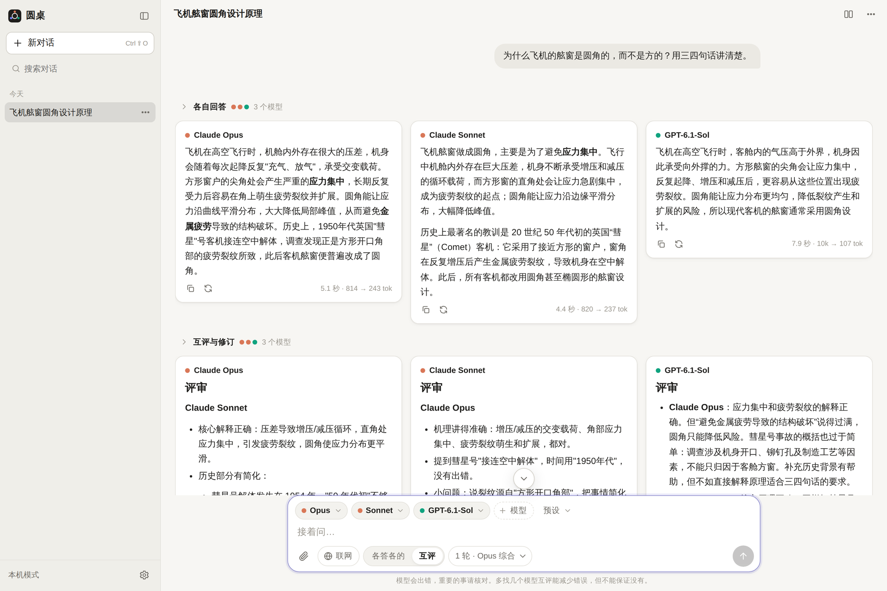

# 圆桌 Roundtable

一个自己部署、自己用的多模型聊天页面：把同一个问题同时交给几个模型，让它们**互相挑错、各自修订**，最后由你指定的一个模型**写一份综合稿**：哪些是大家都认同的，哪些地方说法不一样、各自怎么说。

[English summary](#english) · [安装与部署](docs/deploy.md) · [登录怎么配](docs/login.md) · [模型后端与各家规则](docs/backends.md) · [接外部工具（MCP）](docs/mcp.md) · [安全说明](docs/security.md)



## 它做什么

- **并排回答**：一条消息同时发给最多 6 个模型（可调），各答各的，边生成边显示。
- **互评与修订**：每个模型看到其他模型的回答，指出问题，再修订自己的答案。可以设 1–3 轮，也可以事后对某一轮追加。
- **综合**：指定一个模型读完所有人的最终版本，像写文献综述那样整理成一份：共识是什么、分歧在哪里、每一方（点名）怎么说，最后才是综合者自己更支持谁。默认不会为了给出统一答案而把分歧抹平。可以加一段自己的“综合要求”改变写法，比如只看分歧，或者反过来要一份合并好的答案。
- **三种后端，装了哪个用哪个**：
  - **Claude Code**（`claude -p`）——用你自己的 Claude 订阅或 API 密钥
  - **Codex CLI**（`codex exec`）——用你自己的 ChatGPT 订阅或 API 密钥
  - **OpenRouter**——按量付费，几百个模型
- **附件**：图片、PDF（含扫描版）、Word / Excel / PowerPoint、文本和代码文件。
- **联网搜索**、**画图**（支持的模型）、思考过程和搜索记录可展开查看。
- **外部工具（MCP）**：在网页上接入远程 MCP 服务器，接一次对所有模型生效；支持固定令牌和 OAuth。默认一个都不接，接之前请读 [docs/mcp.md](docs/mcp.md) 里的风险说明。
- **生成在服务器上进行**：关掉浏览器、手机锁屏都不影响，回来接着看。
- 对话搜索、导出 Markdown、收藏模型、自定义指令、用量统计、深色模式、手机可用。
- **不需要构建**：一个 Python 进程 + 一个 SQLite 文件；前端是原生 ES 模块，第三方库都放在仓库里，不连任何 CDN。

互评能减少错误，但不能保证没有——几个模型可能一起错。

## 先看这三条

1. **这是给一个人自己用的。** 没有多用户隔离。如果用的是个人订阅（Claude、ChatGPT），请只给自己用：把个人订阅账号给别人用，是 Anthropic 和 OpenAI 的条款明确不允许的。详见 [docs/backends.md](docs/backends.md) 的“规则”一节。
2. **你对自己的账号负责。** 圆桌只是调用你机器上装好的官方命令行程序，或者用你的密钥发请求。怎么用才符合各家服务条款，由你自己判断和承担；条款会变，文档里的引用只代表写下它那天的情况。**因为使用本项目导致的账号限制、封禁、费用或其它任何损失，作者不承担责任。** 本项目与 Anthropic、OpenAI、OpenRouter、Google 没有关联。
3. **不要不设登录就放到公网上。** 默认配置只监听本机。要从别处访问，先看 [docs/login.md](docs/login.md)。

## 五分钟跑起来（本机）

需要 Python 3.11+，以及至少一个后端（见下）。

```bash
git clone <这个仓库的地址> roundtable
cd roundtable
python3 -m venv .venv
.venv/bin/pip install -r requirements.txt
cp .env.example .env

.venv/bin/python -m roundtable check     # 看看哪些后端能用
.venv/bin/python -m roundtable           # 启动，然后打开 http://localhost:8050
```

后端任选其一就能用：

| 后端 | 最短的配法 | 费用 |
|---|---|---|
| Claude Code | 装好后运行 `claude auth login` | 订阅额度，或 API 按量 |
| Codex CLI | 装好后运行 `codex login` | 订阅额度，或 API 按量 |
| OpenRouter | `.env` 里填 `OPENROUTER_API_KEY=...` | 按量 |

命令行程序要用**运行圆桌的那个系统用户**登录。详细步骤、API 密钥的配法、各家规则原文：[docs/backends.md](docs/backends.md)。

## 放到服务器上

三种登录方式（`.env` 里的 `ROUNDTABLE_AUTH`）：

| 方式 | 适合 | 说明 |
|---|---|---|
| `none`（默认） | 只在本机用，或者通过 SSH 隧道用 | 不登录，但只允许监听 `127.0.0.1`；配成别的地址会拒绝启动 |
| `google` | 放在公网上，**推荐** | 用 Google 账号登录，只放行你列出的邮箱。配置教程约 10 分钟 |
| `password` | 不想用 Google | 一个长密码。有防暴力破解的锁定，没有二次验证 |

教程和“密码登录到底安不安全”的说明：[docs/login.md](docs/login.md)。  
systemd、HTTPS、反向代理、备份、升级：[docs/deploy.md](docs/deploy.md)。

## 安全上做了什么

- 每个请求都在应用最外层检查登录，包括静态文件和推送流；不用 WebSocket。
- 聊天里的模型只能说话、联网搜索、画图：命令执行、文件读写、插件、你机器上给命令行工具配的 MCP 都关掉了；Codex 在 Linux 上还多套一层 bubblewrap 沙箱。隔离做不到的后端会被直接停用，而不是带着缺口跑。
- 唯一的例外是你自己在网页上接进来、并且逐个勾选过的 MCP 工具。令牌留在圆桌这边，不交给模型。这一块的风险由你自己把握，见 [docs/mcp.md](docs/mcp.md)。
- 跨站请求防护、严格的内容安全策略、模型输出清洗后才渲染。

也有没防住和没验证过的地方，都写在 [docs/security.md](docs/security.md) 里了，部署前请读一遍。建议用一个专门的、没什么权限的系统用户来跑。

## 已知的限制

- 只在 **Linux** 上测试过：Ubuntu 24.04 + Python 3.12，配的是 Claude Code 2.1 和 Codex CLI 0.163；另在全新的 Ubuntu 26.10 + Python 3.14 上从头部署过一遍（Codex CLI 0.167；只验证到能启动、检测通过，没有在上面跑真实回答）。macOS 没有测过（没有 bubblewrap 沙箱）；Windows 没有测过。
- Google 登录的流程用模拟的身份提供方完整测过，真实的 Google 账号只在一次部署上走通过（公网 IP + sslip.io 域名）。遇到问题请提 issue。
- MCP 功能是用模拟的 MCP 服务器和模拟的 OAuth 授权服务器测的，没有对着各家真实的 MCP 服务逐一验证过。
- 界面只有中文，给模型的系统提示词也是中文写的（模型会按你提问的语言回答）。
- 单用户。没有账号体系、没有分享链接、没有多人协作。
- Claude Code 和 Codex 的命令行参数会随版本变化；圆桌启动时会检测，但新版本可能需要这边跟着改。
- 数据库升级只会自动补上新增的表和列，没有更完整的迁移机制，升级前请备份数据目录。

## 许可

[MIT](LICENSE)。用到的第三方组件见 [THIRD_PARTY.md](THIRD_PARTY.md)。

---

<a name="english"></a>

## English

**Roundtable** is a small self-hosted chat UI for asking several LLMs the same question at once, having them **critique each other and revise**, and then letting one model you pick **write a synthesis** — what they agree on, where they differ and who said what — without flattening the disagreements. You can add your own instructions for the synthesis.

- Backends: **Claude Code** (`claude -p`), **Codex CLI** (`codex exec`) and **OpenRouter**. Use whichever you have; the two CLIs are the unmodified official binaries, run as subprocesses under your own login.
- Attachments (images, PDF, Office documents, text/code), web search, image output, visible reasoning/search traces.
- Runs continue on the server when you close the tab.
- One Python process and one SQLite file. No build step, no CDN.
- Three auth modes: `none` (loopback only), `google` (OIDC with an e-mail allowlist) and `password` (single password with lockout).
- Chat models are restricted to talking, web search and image generation: no shell, no file access, no plugins, and none of the MCP servers configured for the CLIs on your machine; Codex additionally runs inside bubblewrap on Linux.
- Optional **MCP tools**: add remote MCP servers (Streamable HTTP; static token or OAuth) in the web UI and tick the tools you want; they then work with every backend. Nothing is connected by default, and tokens stay on the server side. Read the risks in [docs/mcp.md](docs/mcp.md) first — tool calls are not confirmed one by one.

The UI and the documentation are currently Chinese only. Quick start:

```bash
git clone <repo-url> roundtable && cd roundtable
python3 -m venv .venv && .venv/bin/pip install -r requirements.txt
cp .env.example .env
.venv/bin/python -m roundtable check
.venv/bin/python -m roundtable        # http://localhost:8050
```

**Please read before use:** this is a single-user tool. If you run it on a personal Claude or ChatGPT subscription, keep it to yourself — sharing subscription access with other people is against the providers' terms. You are responsible for complying with the terms of every service you connect; the authors accept no liability for account restrictions, bans, charges or any other consequence of using this software. Not affiliated with Anthropic, OpenAI, OpenRouter or Google. Tested on Linux only. MIT licensed, provided as is.
